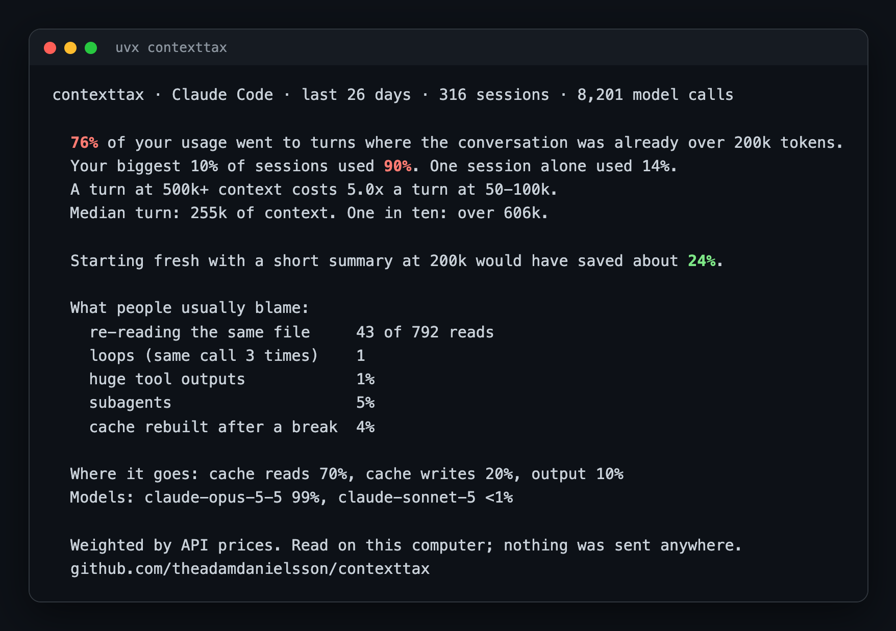

# contexttax

Where your Claude Code usage actually goes.

Most of it isn't loops or re-reads. It's long conversations. Every turn sends the whole conversation again, so a session at 500k tokens pays for all of it on every message.

```
uvx contexttax
```

No install with uv. Or, with plain Python 3:

```
curl -fsSL https://raw.githubusercontent.com/theadamdanielsson/contexttax/main/contexttax.py | python3 -
```

## What it shows

My last 26 days:



## The fix

If most of your usage goes to long conversations, one setting changes it. Add this to `~/.claude/settings.json`:

```json
"autoCompactWindow": 200000
```

Claude Code then compacts at 200k instead of near the limit. Or use `/autocompact` to set it from a session. The trade-off: it summarises more often, so a very long task may lose some early detail. contexttax tells you when this applies to you, and when you've already set it.

## Private by design

It reads the logs Claude Code already keeps in `~/.claude/projects`. It prints numbers only. It sends nothing anywhere and writes nothing. One file, standard library only, so you can read all of it first.

## How it counts

Usage is weighted by API prices, the closest public stand-in for how plan limits are counted. Per model: Opus 5, Sonnet 3, Haiku 1. Within a model: input 1, cache write 1.25 (5-minute) or 2 (1-hour), cache read 0.1, output 5. Plan limits aren't published, so treat the shares as close, not exact.

The fresh-start saving assumes each turn past 200k would instead carry a 20k summary. It ignores what a summary leaves out.

## Options

```
contexttax --days 7     # last week
contexttax --days 0     # everything in the logs
contexttax --json       # the numbers as JSON
contexttax --share      # a few lines to paste anywhere
```

## Share yours

`contexttax --share` prints a few lines you can paste anywhere:

```
76% of my Claude Code usage went to turns where the conversation was already past 200k tokens.
My biggest 10% of sessions used 90%.
Re-reads, loops and huge tool outputs barely registered.
Find yours: uvx contexttax
```

If your numbers look different from mine, I'd like to see them. Open an issue with the output.

MIT licence.
